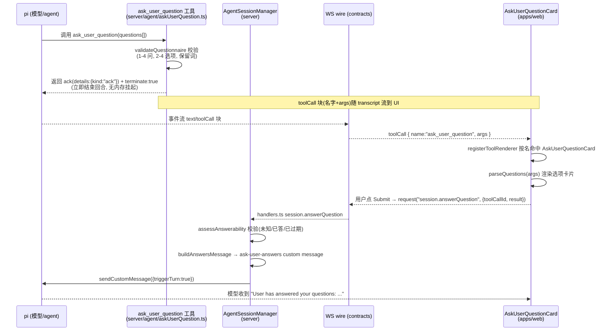

# `ask_user_question` 确认卡实现说明

当 agent 需要和用户确认时，UI 上显示的确认卡（选项、提交等）由 pi 的 `ask_user_question` 工具驱动。核心架构是 **「能力」和「呈现」两半，靠 tool 名 `ask_user_question` 拼起来**（见 `apps/web/src/chat/tools/SPEC.md` 开头的约定）。

## 整体流程



## 1. 服务端：`ask_user_question` 是宿主自有的 pi 自定义工具

`packages/server/src/agent/askUserQuestion.ts`

- **Schema（TypeBox）**：`AskUserQuestionSchema` 约束模型输出 —— 1–4 个问题、每题 2–4 个选项、`header` ≤16 字符、`label` ≤60 字符、`recommendedReason` ≤160 字符，并保留词 `RESERVED_LABELS = ["Other", "Type something.", ...]`（模型不许自己造 Other/Skip）。
- **`validateQuestionnaire`**：纯校验（问题文本唯一、选项 label 唯一、不撞保留词、数量上下限）。
- **`createAskUserQuestionTool().execute`**：这是关键设计 —— **ack + terminate**，不是阻塞等待：

```ts
if (!ctx.hasUI) return toolResult(ERROR_NO_UI, ...);   // 非交互环境直接拒绝
const validation = validateQuestionnaire(args);
if (!validation.ok) return toolResult(validation.message, ...);
return {
  content: [{ type: "text", text: ASK_ACK_TEXT }],
  details: { kind: "ack" },      // 只是 ack
  terminate: true,               // 立即结束本轮，不再发起 LLM 调用
};
```

工具**不等待**答案。它校验后立刻返回 ack 并 `terminate: true`，回合在 tool 批次处结束。好处（记在 `agent/SPEC.md`）：transcript 立刻完整、provider 合法，宿主重启后问卷还能存活，因为没有挂在内存里的 promise。

## 2. 契约层：类型 + 回复 wire op

`packages/contracts/src/piProtocol.ts`

- `AskUserQuestionItem` / `AskUserQuestionOption` / `AskUserQuestionArgs`（工具入参）
- `AskUserQuestionAnswer`（`kind: "option" | "custom" | "multi"`，含 `selected`、`notes`、`preview`）
- `AskUserQuestionResult = { answers: AskUserQuestionAnswer[]; cancelled: boolean }`

`packages/contracts/src/wsProtocol.ts`

- 回复操作：`"session.answerQuestion": { params: { sessionId, toolCallId, result }, result: Ack }`

## 3. UI 侧：按 tool 名注册渲染器

`apps/web/src/chat/tools/register.ts` —— `registerToolRenderer("ask_user_question", AskUserQuestionCard, { chrome: "bare" })`。

`apps/web/src/chat/toolRegistry.tsx` 维护 `toolName → renderer` 的 Map，未注册的落到 `DefaultToolRenderer`。`chrome: "bare"` 表示卡片自己管满宽边框、永不折叠。

## 4. 卡片本体：`AskUserQuestionCard.tsx`

这是最重的部分，几个关键点：

- **生命周期不来自 tool status，而来自 transcript**（`askState.ts`）：因为工具是 ack+terminate，它自己的 result 只是 ack，所以卡片用 `useAskState(toolCallId)`（`deriveAskStates` 扫 turns，找 `toolCall` 块 id 和之后的 user 消息）来判断状态，按优先级渲染：
  - **answered** → 展示已选答案的静态记录（`ResolvedRecord`）
  - **superseded** → 用户在聊天里直接回了自由文本、没用卡片 → 终端态紧凑记录（`SupersededRecord`）
  - **awaiting** → 交互式问卷
- **选项渲染**（`QuestionBody`）：单选 / 多选（`multiSelect`）、键盘操作（↑↓ 移动、Space 选择/切换、Enter 确认、Tab 加 note）、"Other" 自定义输入、选项的 markdown `preview`、`recommendedReason` 的 "Why:" 行。
- **多问 review 门**：每题用 **Next** 前进（含最后一题），只有合成的 **Review & submit** 页才暴露 **Submit**；单问直接 Submit。
- **提交构造**：`deriveAnswer` / `deriveAnswers` 把每个 `QState`（选中的 option、custom text、notes、multi 选中集）折成 `AskUserQuestionAnswer[]`，`reply()` 里调用 `actions.answerQuestion(toolCallId, result)`。
- **`reply`** 三种出口：Submit（`cancelled:false`）、Skip（`cancelled:true`、空 answers）、Shift+Esc（cancel）。发送中显示 `WaitingCard`「Answer sent — continuing…」，失败则 `setSubmitted(false)` 回到可交互。

## 5. 提交链路（把答案送回 agent）

1. `AskUserQuestionCard.reply()` → `ChatActions.answerQuestion`（context 注入，见 `ChatActions.tsx`）。
2. `ChatView.tsx` 里绑定：`answerQuestion = (toolCallId, result) => getTransport().request("session.answerQuestion", { sessionId, toolCallId, result })`。
3. 服务端 `packages/server/src/host/handlers.ts` 的 `session.answerQuestion`：先形状校验，再 `ackSend(answerQuestion(...))`。
4. `packages/server/src/agent/agentSessionManager.ts` 的 `answerQuestion`：
   - `assessAnswerability(session.messages, toolCallId)` 否决过期/重复答案（unknown_call / already_answered / not_awaiting / superseded）。
   - `buildAnswersMessage` 把答案包成 `ask-user-answers` custom message（`details:{toolCallId, result}`，文本是 `buildQuestionnaireResponse` 生成的 `"User has answered your questions: ..."` 信封）。
   - `session.sendCustomMessage({ triggerTurn: true })` 启动新一轮，模型把答案当作下一条用户消息。

## 注意区分：`ExtUiDialog` 是另一套机制

`apps/web/src/chat/ExtUiDialog.tsx`（配合 `session.extUiReply`）是 pi 的 **`extensionUi` 交互桥** —— 处理 `confirm`/`select`/`input`/`editor` 四类模态弹窗，走的是 `ctx.ui.custom`，和 `ask_user_question` 的内联问卷卡是**两条独立路径**，别混。

## 关键文件索引

| 层 | 文件 |
| --- | --- |
| 工具能力 + 校验 + ack | `packages/server/src/agent/askUserQuestion.ts` |
| 答案校验 + 注入消息 | `packages/server/src/agent/agentSessionManager.ts` |
| WS handler | `packages/server/src/host/handlers.ts` |
| 契约类型 | `packages/contracts/src/piProtocol.ts` |
| 回复 wire op | `packages/contracts/src/wsProtocol.ts` |
| 渲染器注册 | `apps/web/src/chat/tools/register.ts` |
| 渲染器 registry | `apps/web/src/chat/toolRegistry.tsx` |
| 确认卡本体 | `apps/web/src/chat/tools/AskUserQuestionCard.tsx` |
| 生命周期派生 | `apps/web/src/chat/askState.ts` |
| 提交动作绑定 | `apps/web/src/chat/ChatView.tsx` |
| 扩展 UI 弹窗（另一套） | `apps/web/src/chat/ExtUiDialog.tsx` |
